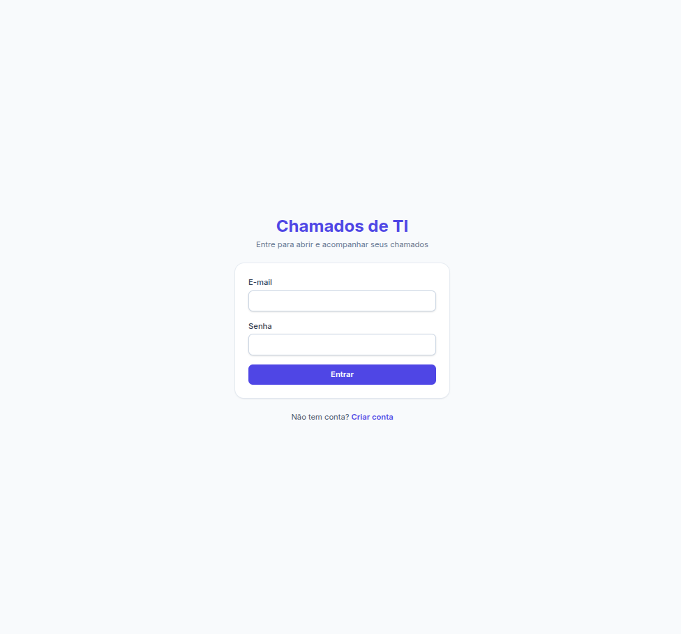
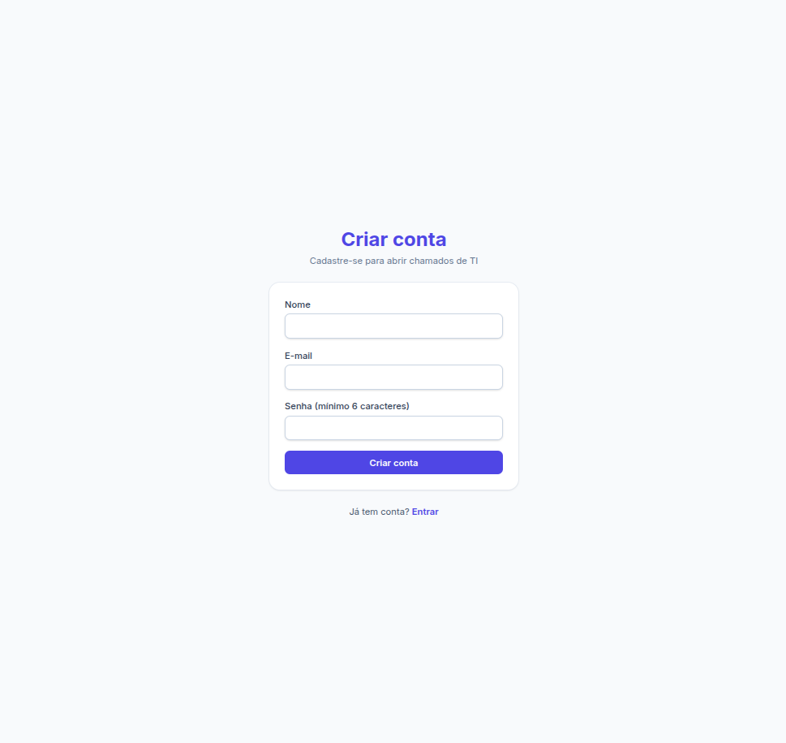
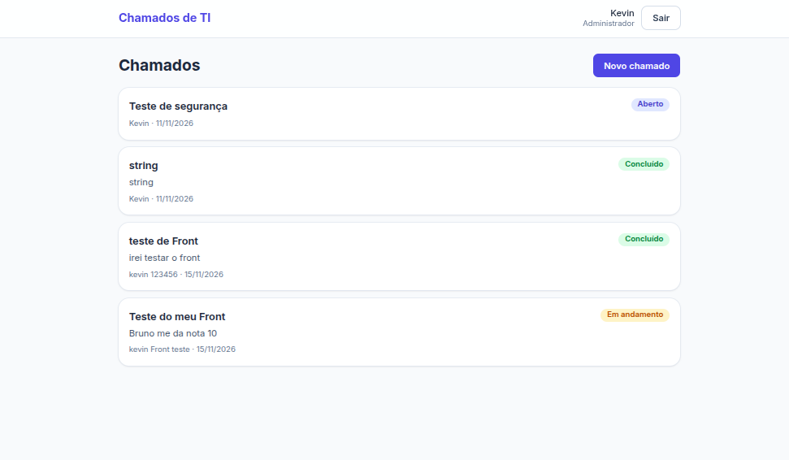
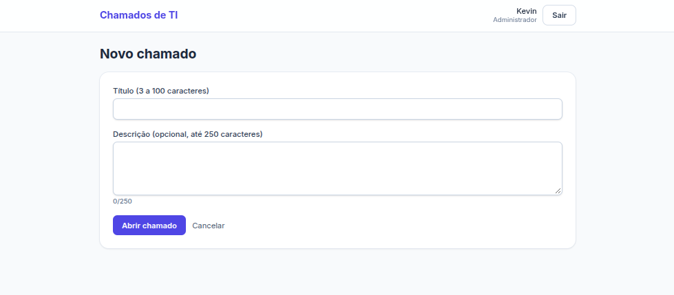
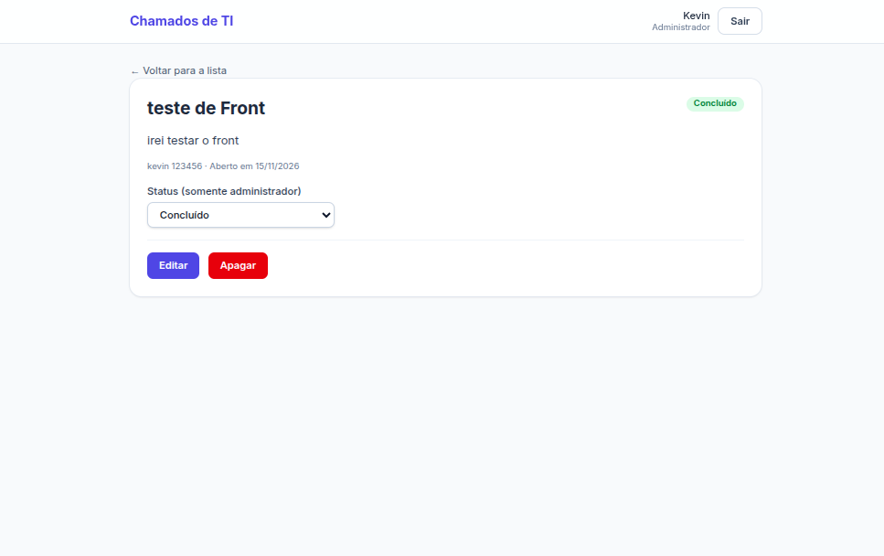

# Chamados de TI — Front-end

Interface web para um sistema de chamados de suporte de T.I. Usuários abrem e acompanham seus chamados; administradores veem todos e alteram o status. O front consome a API em NestJS do projeto [Chamada-T.I](https://github.com/Kevin-FDev/Chamada-T.I) e mantém a sessão por **cookie `httpOnly`**.

## Capturas de tela

| Login | Cadastro |
|---|---|
|  |  |

| Lista de chamados (admin) | Novo chamado |
|---|---|
|  |  |

| Detalhe com status (admin) | Versão para celular |
|---|---|
|  | .png) |

## Tecnologias

**Front-end**

- React + TypeScript (Vite)
- React Router (rotas e rotas protegidas)
- Tailwind CSS v4 (estilos e tema de cores)
- Fonte Inter (`@fontsource-variable/inter`, instalada no projeto)
- `fetch` com `credentials: 'include'` (envio do cookie)

**Back-end (repositório separado)**

- NestJS + TypeScript
- PostgreSQL (Docker) + Prisma
- JWT guardado em cookie `httpOnly`
- Documentação Swagger em `/api`

## Principais funcionalidades

- **Autenticação:** login, logout e cadastro de usuário. A sessão fica em cookie `httpOnly`, que o JavaScript do navegador não consegue ler.
- **Rotas protegidas:** quem não está logado é enviado para `/login`. Se a sessão expirar (1 hora), o usuário volta ao login com um aviso.
- **Chamados:** listar, criar, ver detalhe, editar e apagar (com confirmação).
- **Perfis:**
  - Usuário comum: vê apenas os próprios chamados.
  - Administrador: vê todos, com o nome do dono, e altera o status (Aberto, Em andamento, Concluído).
- **Feedback:** mensagens de carregamento, sucesso e erro, inclusive quando o servidor está fora do ar.
- **Responsivo:** funciona no computador e no celular.

## Pré-requisitos

- [Node.js](https://nodejs.org/) 22.22 ou mais novo
- [pnpm](https://pnpm.io/)
- [Docker](https://www.docker.com/) com Docker Compose
- Git

## Como executar o sistema completo

O sistema tem **dois projetos**: o back-end (API na porta `3000`) e este front-end (porta `5173`). Os dois precisam estar rodando.

### 1. Back-end

```bash
git clone https://github.com/Kevin-FDev/Chamada-T.I.git
cd Chamada-T.I
pnpm install
cp .env.example .env
```

Abra o `.env` e ajuste os valores. Se mudar `POSTGRES_USER`, `POSTGRES_PASSWORD` ou `POSTGRES_DB`, use os mesmos valores dentro da `DATABASE_URL`. Troque também o `JWT_SECRET` por um texto longo e aleatório.

Suba o banco de dados e crie as tabelas:

```bash
docker compose up -d
pnpm exec prisma migrate deploy
```

Inicie a API:

```bash
pnpm run start:dev
```

A API fica em `http://localhost:3000` e o Swagger em `http://localhost:3000/api`.

### 2. Front-end

Em **outro terminal**:

```bash
git clone <URL-DO-REPOSITORIO-DO-FRONT>
cd <PASTA-DO-FRONT>
pnpm install
cp .env.example .env
pnpm dev
```

Abra `http://localhost:5173`.

> O front precisa rodar na porta `5173`, porque o back libera o CORS para esse endereço. Para usar outra porta, altere `FRONT_URL` no `.env` do back.

## Variáveis de ambiente

### Front-end (`.env`)

| Variável | Descrição | Exemplo |
|---|---|---|
| `VITE_API_URL` | Endereço da API | `http://localhost:3000` |

O arquivo `.env.example` já traz esse valor. O `.env` não vai para o Git.

### Back-end (`.env`)

| Variável | Descrição |
|---|---|
| `PORT` | Porta da API (padrão `3000`) |
| `POSTGRES_USER` / `POSTGRES_PASSWORD` / `POSTGRES_DB` | Dados do banco usados pelo Docker |
| `DATABASE_URL` | String de conexão com o PostgreSQL |
| `JWT_SECRET` | Segredo usado para assinar o token |
| `FRONT_URL` | Endereço do front liberado no CORS (padrão `http://localhost:5173`) |

## Orientações de uso

1. Abra `http://localhost:5173/cadastro` e crie uma conta. Ela nasce como **usuário comum**.
2. Faça login. Você vai para a lista de chamados.
3. Clique em **Novo chamado**, preencha o título (3 a 100 caracteres) e, se quiser, a descrição (até 250).
4. Clique em um chamado para ver o detalhe, **editar** ou **apagar**.
5. Use **Sair** na barra do topo para encerrar a sessão.

### Como virar administrador

A API não permite se promover a admin. É preciso alterar o banco direto. Com o Docker rodando, na pasta do **back-end**:

```bash
docker compose exec postgres sh -c 'psql -U "$POSTGRES_USER" -d "$POSTGRES_DB"'
```

Dentro do `psql`, troque o e-mail e rode:

```sql
UPDATE "Usuario" SET papel = 'ADMIN' WHERE email = 'seu-email@exemplo.com';
\q
```

Saia do sistema e entre de novo para o novo papel valer. O administrador passa a ver todos os chamados e a alterar o status na tela de detalhe.

## Organização do projeto

```
src/
├── components/   Peças reaproveitáveis (Button, Input, Alert, Card, StatusBadge,
│                 ChamadoForm, Layout, ProtectedRoute)
├── contexts/     Estado compartilhado de autenticação (AuthContext, AuthProvider)
├── pages/        Telas (Login, Cadastro, Chamados, NovoChamado,
│                 DetalheChamado, EditarChamado)
├── services/     Comunicação com a API (api, authService, usuarioService,
│                 chamadoService)
├── types/        Tipos TypeScript (Usuario, Chamado, StatusChamado)
├── App.tsx       Definição das rotas
├── main.tsx      Ponto de entrada
└── index.css     Tema de cores e fonte (Tailwind)
```

### Decisões de projeto

- **Cookie `httpOnly`:** o token não fica acessível ao JavaScript, o que reduz o risco de roubo por scripts maliciosos. Por isso o token não é guardado em `localStorage`.
- **Camada de serviços:** as telas não chamam `fetch` direto. Todas passam pelo `api.ts`, que concentra o endereço da API, o envio do cookie e o tratamento de erros.
- **Contexto de autenticação:** guarda quem está logado e é consultado pelas rotas protegidas e pela barra do topo.
- **Componentes reaproveitáveis e tema único:** as cores da marca ficam no `index.css`, então trocar a paleta muda o sistema inteiro.

## Scripts

| Comando | O que faz |
|---|---|
| `pnpm dev` | Inicia o servidor de desenvolvimento |
| `pnpm build` | Compila o projeto para produção |
| `pnpm lint` | Verifica o código com o ESLint |

## Autor

Kevin — Análise e Desenvolvimento de Sistemas.